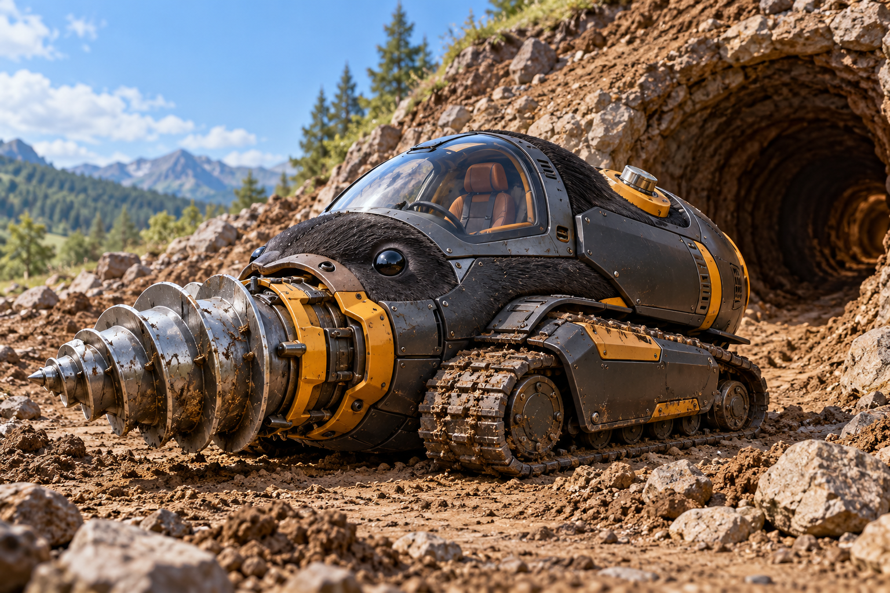

# DrillMole — крот-бур «Копатель»



Реализация класса `DrillMole` по SPEC.md
(стихия — земля, конструкционный элемент — бур).

Крот ездит по поверхности и прокапывает ходы под землёй. Под землёй можно
пройти под рекой и под стеной, но бур изнашивается и его нужно менять —
только на поверхности. Плавать крот не умеет.

## Требования

- Python 3.9 и новее (проверено на 3.10.11);
- сторонние библиотеки не нужны, только стандартная библиотека.

Проверить версию: `python --version`.

## Запуск тестов

Из корня репозитория выполните:

```
python -m unittest discover -s tests -t . -v
```

Текущий набор содержит 36 тестов. Статус приёмки и оставшиеся замечания — в [ACCEPTANCE.md](ACCEPTANCE.md).


Запуск отдельного тестового модуля:

```
python -m unittest tests.test_drill_mole -v
python -m unittest tests.test_drill_mole_scenarios -v
python -m unittest tests.test_review_regressions -v
python -m unittest tests.test_acceptance_regressions -v
```

## Проверка стиля

```
pip install flake8
flake8 drill_mole.py
```
